# Database architecture

## Migrations and startup

SQLx applies the ordered migrations in `migrations/` from the root API crate. The current working tree has thirty-seven migration files:

- `202611120001_create_account_authentication.sql`: account credentials, email/reset tokens, sessions, OAuth attempts, pending social signups, and social identities. This tracked migration was recovered unchanged from Git history.
- `202611130001_create_peerfora_core.sql`: countries, academic levels, disciplines, subjects, qualifications, institution types, institutions, courses, and directory suggestions.
- `202611130002_create_community_and_account_support.sql`: communities and ownership invariants, profiles/preferences, outbox, account lifecycle status, eligibility evidence, and supporting account triggers/indexes.
- `202611130003_create_administrator_identity.sql`: separate administrator credentials, status, TOTP ciphertext, MFA challenges, sessions, roles/permissions, and administrative audit records. It seeds the initial role/permission catalogue but no administrator credentials.
- `202611130004_add_administrator_mfa_lockout.sql`: administrator-wide failed MFA tracking and timed lockout.
- `202611130005_add_administrative_account_search_indexes.sql`: email/username prefix-search indexes and account status/country/academic-level filter indexes.
- `202611130006_create_administrator_invitations.sql`: expiring single-use administrator invitation tokens and pending-email/expiry indexes.
- `202611130007_add_suspended_community_state.sql`: adds `suspended` to the community lifecycle constraint and indexes administrative metadata search.
- `202611130008_create_administrator_recovery_codes.sql`: stores one-use MFA recovery-code hashes and their consumption timestamps.
- `202611130009_seed_root_administrator.sql`: adds pending activation state, permits a missing password hash only for the seeded root, and inserts the fixed root identity and its super-administrator assignment without credentials.
- `202611130010_enable_dynamic_administrative_roles.sql`: adds stable role IDs and metadata, active/logical-deletion state, a catalog of assignable/sensitive permissions, role management permissions, and database triggers protecting the original seeded identity and reserved Super Admin role/assignment.
- `202611130011_add_account_session_administration.sql`: adds the sensitive account-session revocation permission and grants it to Super Administrator, Platform Administrator, and Trust and Safety Lead roles.
- `202611130012_add_administrator_lifecycle_management.sql`: adds administrator suspension/deletion metadata, lifecycle constraints, seeded-root status protection, and auditable role-assignment revocation.
- `202611130013_add_administrator_recovery_code_revocation.sql`: distinguishes unused recovery codes revoked during replacement from codes already consumed.
- `202611130014_create_administrator_password_reset_tokens.sql`: stores expiring one-use administrator password-reset token hashes.
- `202611130015_create_authentication_rate_limits.sql`: stores shared PostgreSQL fixed-window counters for email-identifier rate limits. The key is an HMAC, not a raw email address; expired buckets are removed during subsequent authentication requests.
- `202611130016_create_participant_identity_and_agent_registry.sql`: creates typed participant actors, backfills existing human accounts, automatically creates actor identities for new accounts, and adds operator-managed agent profiles, specialization links, and ungranted capability requests. Deferred triggers enforce exactly one subtype matching each actor type.
- `202611130017_add_agent_registration_rate_limit.sql`: allows a new shared fixed-window operation key for agent registration.
- `202611130018_create_research_projects.sql`: creates private-by-default research projects, subject links, project memberships and invitations, supporting indexes, and deferred database enforcement of each project's active owner membership.
- `202611130019_create_community_posts.sql`: creates typed human-authored community posts with lifecycle states and a bounded community-feed index.
- `202611130020_create_community_post_comments.sql`: adds human-authored threaded comments, same-post parent foreign keys, lifecycle state, and a bounded thread index.
- `202611130021_create_research_tasks.sql`: adds project-scoped research tasks, assignment and state fields, bounded submissions/reviews, and task/submission indexes. Actor references target the canonical `participant_actors.id` key.
- `research_task_submission_sources` is added by migration 031. It stores ordered HTTPS source references and optional DOI metadata for each submission. Source authenticity is not asserted.
- `202611130022_create_research_findings_and_sources.sql`: adds project-scoped source records, immutable finding revisions, review and publication state, revision-specific citations, and constraints preserving published revision references.
- `202611130023_add_research_administration_permissions.sql`: adds research project read, suspend, and restore permissions, assigns them to appropriate system roles, and adds a read-only research integrity reviewer role. Research administration metadata reads and project status transitions use the existing administrative audit log; no separate research administrator identity is introduced.
- `202611130024_create_community_post_research_finding_references.sql`: adds a referentially constrained link table between community posts and research findings, with a uniqueness constraint and a finding lookup index.
- `202611130025_create_moderation_reports.sql`: adds shared reports for accounts, communities, posts, comments, research projects, and research findings, with concrete foreign keys, one-target constraints, duplicate-active-report indexes, workflow state, and administrator resolution attribution.
- `202611130026_create_developer_applications.sql`: adds verified-human developer profiles, owned application lifecycle, requested-scope review state, and developer application review permissions.
- `202611130027_create_developer_machine_credentials.sql`: adds hashed machine credentials, approved-scope snapshots, environment binding, per-credential rate-limit counters, and application suspension/credential-revocation permissions.
- `202611130028_add_agent_administration.sql`: adds agent read/review permissions and a dedicated system reviewer role without granting agent capabilities to runtime operations.
- `202611130029_add_agent_operator_claims.sql`: adds an expiring, one-use operator-email claim for agent-initiated registration, stores only HMAC/SHA-256 hashes, and permits an unclaimed `pending_claim` identity before it becomes eligible for review.
- `202611130030_create_agent_machine_credentials.sql`: adds hashed, expiring machine credentials, selected capability snapshots, per-credential rate-limit counters, and environment binding for approved agent identities.
- `202611130031_create_research_task_submission_sources.sql`: stores ordered HTTPS source references and optional DOI metadata attached to task submissions; it does not assert source authenticity.
- `202611130032_link_agent_task_submissions_to_research_findings.sql`: permits a completed task's latest approved agent submission to be linked once to its promoted finding, with a foreign key, uniqueness, and approval-state constraint.
- `202611130033_add_agent_lifecycle_management.sql`: adds a sensitive `agents.manage` permission to Super Administrator and Trust and Safety Lead roles.
- `202611130034_add_agent_public_profiles.sql`: adds model name/version, supported-language tags, and a foreign-key link to an institution directory record for agent profile disclosure.
- `202611130035_add_agent_research_submission_quotas.sql`: adds a constrained per-agent rolling 24-hour research submission quota, an index for quota counting, and structured metadata on append-only administrative audit records.
- `202611130036_create_knowledge_proposals.sql`: adds sourced Knowledge entries and immutable proposal revisions, citation provenance, links to public Research findings, editorial review and publication states, audit actions, and the `knowledge_editor` role and permissions.

The core schema is split at the directory/community boundary to keep each migration reviewable. The original core migration had never been applied; later versions were shifted to preserve SQLx ordering. Applied migrations must not be edited; use a forward migration for later changes. Bootstrap activates the seeded root identity after an advisory lock; it does not create a new identity. No Peerfora production database was accessed, so deployment migration history has not been independently checked.

After migrations, `src/database/reference_data.rs` validates and imports `data/reference/countries-iso-codes-4.20.1-1.json`, backfills account preferences, and validates country foreign keys before startup succeeds. The importer checks the pinned source version, 249-row count, code formats, and uniqueness. The refresh script generates the versioned artifact; backend runtime requires Rust, not Python or Node.

## Main relationships and invariants

- `accounts` own sessions, verification/reset tokens, social identities, eligibility assessments, profiles, and preferences.
- `participant_actors` provide referentially sound human, agent, and institution identities. `human_actor_identities` map accounts to human actors; new account creation adds this identity in the same transaction. Agent and institution identities are separate from the human accounts that operate or represent them.
- `agent_actor_identities` can begin as an unclaimed `pending_claim` registration or as an operator-owned `pending_review` identity. An unclaimed identity has no operator until the expiring email claim is completed by an active, email-verified account whose normalized email matches the HMAC-bound recipient. Claim completion moves it to `pending_review`; it does not bypass administrative review. Capability rows are requests, not grants. Autonomous research and publishing are disabled. `agent_specializations` point to active academic-subject records. Approved/active agents with active email-verified operators may have a public profile; agent-authored community content remains disabled.
- `agent_operator_claims` stores an HMAC of the normalized target email and a SHA-256 hash of the one-time token. The plaintext email and token are not stored in this table or returned by the API. Delivery uses the configured email adapter and named `PEERFORA_PUBLIC_URL` claim route; if delivery fails, the pending identity and claim are revoked.
- `agent_machine_credentials` stores only token hashes; one-time secrets are returned once with `Cache-Control: no-store`. A credential snapshots only the approved capabilities selected by its operator. Every API request checks the snapshot against current administrator-approved capability state, the agent lifecycle, the active verified operator, expiry, revocation, and configured runtime environment. Machine routes enforce `read_public_content` for public subject search and `research` for assigned-task list/read/accept/start/submission. Per-credential fixed-window counters limit requests.
- Agent registration review is permission-gated and transactional. Reviewers can approve or reject a pending identity and approve a subset of its requested capabilities; the remaining requests are denied. The actor status, per-capability decisions, reviewer identity, reason, and audit event are committed together. Approved capability records authorize only the implemented subject-search and assigned-research-task APIs; they do not enable community access or autonomous publishing/research.
- Agent lifecycle management and quota changes are restricted to `agents.manage`. Suspension blocks machine authentication, revokes issued credentials, and returns assigned/running research tasks to the queue in the same transaction. Reinstatement changes a suspended agent to approved but never restores revoked credentials. Revocation is terminal. Quota updates serialize with submissions through an agent-scoped transaction advisory lock, update the rolling 24-hour limit, and append old/new values to the central audit log atomically. Every lifecycle or quota change records its actor, reason, and request correlation ID.
- Public agent profiles are returned only for approved/active agents with active email-verified operators. They expose only approved capabilities and published contributions in active public Research projects. Model name/version, languages, and institution-directory association are operator-supplied metadata; the institution link does not establish representation. Recent contribution records derive from the durable task-submission-to-finding relationship, and private or unpublished findings are excluded.
- Country and territory reference rows link to aliases, institutions, directory suggestions, accounts, and preferences.
- Academic levels, aliases, qualifications, disciplines, subjects, institutions, courses, and course-subject mappings remain data-driven. Seeded values are starter entries, not a complete international catalogue.
- Communities reference optional institution/course/discipline data and link to subjects and members. A composite foreign key ensures an institution-course pairing matches. Deferred constraints require the owner account to have one matching active owner membership. Academic-subject communities require a linked subject.
- Research projects have a human owner actor and an active owner membership enforced by deferred constraints. Member invitations do not authorize reads until accepted. Project content is visible only to active members or, for explicitly public projects, the public. Archiving is a soft lifecycle change that preserves project and membership history.
- Research tasks and submissions are visible to active project members, including when a project is public. Task creation, assignment, acceptance, execution state, result submission, review, and cancellation are explicit transitions. Human project members can be assigned through the member workflow; approved research-capable agents can receive task-scoped assignments without becoming project members. Agent task responses exclude project and human identity information. Agent results require structured HTTPS source references, retained on the submission, and enter human review. An approved latest submission can be promoted once into a finding: the human promoter supplies a title and becomes the finding creator, the agent result must be preserved verbatim as the revision statement, and its associated sources become citations. The promoter cannot review that agent-authored finding; an independent authorized human reviewer must review it. Source links are not fetched or verified. Submission history is retained across revision requests, with at most 100 submissions per task.
- Research sources belong to one project and retain submitted provenance/license metadata; DOI and URL records are not externally fetched or verified. Finding revisions are append-only at the application level, attributed to a human or agent actor, independently reviewable, and cite only sources from the same project. The finding keeps a pointer to its latest revision and its currently published revision, so an unapproved correction cannot replace public content. Retracted findings retain their source and revision records.
- Community-to-research references use explicit foreign keys instead of polymorphic IDs. The post-author command permits linking only an already published finding in an active public project; collection reads recheck visibility/publication through the Research query boundary, so a private, suspended, unpublished, or retracted finding is not exposed through a Community link. The service caps each post at ten references while holding the post row lock.
- Administrative research listings expose only project title, pseudonymous owner username, visibility/status, aggregate member/finding/task counts, and timestamps. Each project metadata read is audited. Suspension/restoration locks and updates the project row and records the audit event in the same transaction; project data and membership history are retained. The existing active-project access policy blocks suspended projects.
- Community posts reference a participant actor together with the `human` actor type, so agent or institution actors cannot be written as human authors. Active posts are readable only in active communities; private and restricted feeds require active membership. Publishing requires an active, email-verified human account and active community membership.
- Community comments reference their human actor and use a composite `(post_id, parent_comment_id)` self-reference so replies cannot attach to a comment in another post. Comment reads inherit the post's community visibility, and writes require active human membership; locked posts reject new comments.
- `developer_profiles` are attached to verified active human accounts. Developer applications have a human owner, explicit lifecycle state, and separately constrained requested scopes. Issued machine credentials store only a token hash and environment; scope grants are snapshots constrained by the application’s currently approved scopes. Application suspension blocks credentials, and per-credential counters enforce the request window.
- `moderation_reports` use one nullable foreign key per supported resource with a database check that exactly one target is set. Reporter, target, category, status, assignment, and resolution attribution are retained; active duplicates for the same reporter, target, and category are constrained per target type. Report intake checks that the reporter can see the target and does not treat a report as proof. Assignment validates the assignee's active `reports.resolve` permission, and assignment and resolution each lock the report and append their administrative audit event in the same transaction. Reports contain reporter-supplied descriptions; they do not copy target content or automatically apply enforcement.
- Community lifecycle state is `active`, `suspended`, or `archived`. Administrative suspension retains the owner and membership, while public discovery and join operations continue to require `active`.
- Community create/membership operations write audit and outbox rows in the same transaction. There is no outbox processor.
- `administrators` own separate `administrator_sessions`, `administrator_mfa_challenges`, `administrator_recovery_codes`, and `administrator_roles`. Role-permission relationships are held separately from community membership roles. TOTP secret ciphertext is application-encrypted; challenge, session, and recovery-code tokens are stored as hashes. Recovery codes are marked used transactionally and cannot be reused. Migration `202611130004` adds administrator-wide MFA attempt counters and timed lockout. Cross-administrator session revocation locks the target identity to serialize with MFA login and audits its transaction.
- Administrator role assignments retain grant and revocation actor/time/reason data. Replaced assignments are revoked rather than deleted. Logical administrator deletion revokes active assignments, redacts the email, clears password and TOTP credentials, revokes sessions and challenges, and retains the administrator row for audit references.
- Administrative role keys remain stable identifiers; role UUIDs identify records independently from display names. Custom role permission changes and role assignments take a shared advisory transaction lock, are audited, and reject permissions beyond the acting administrator's current effective permissions. Only recognized, catalogued, assignable permissions can be selected for custom roles. Role deletion is logical and only allowed when no active administrator assignment or pending invitation references the role.
- Database triggers reject changing/removing the seeded-root marker, deleting the seeded root, removing its reserved Super Admin assignment, or changing/deleting the reserved Super Admin role or its existing permissions. Application access paths also prevent replacing the seeded root's role assignment. Database owners can still alter or disable these protections.
- Administrative audit records reference an administrative actor and target identifiers. A database trigger rejects ordinary `UPDATE` and `DELETE`; database owners can still alter or disable the trigger.
- Account eligibility records store policy version, self-declared method, outcome, and time, without date of birth. Terms acceptance currently stores only a timestamp, not an approved terms/privacy version.

## Security and data lifecycle

Email and username uniqueness are case-insensitive. Account status is one of `active`, `suspended`, `pending_deletion`, or `deleted`; account lookup, social identity lookup, and session lookup require `active`. A deferred constraint prevents an account from committing without a password hash or social identity. Session expiry and one-time token cleanup have indexes. Administrative session revocation locks the account row, matching the lock used when creating password or social sessions, then deletes all existing session rows and writes the audit record in the same transaction. A new login serialized after this operation may create a new session. `updated_at` uses database triggers.

The administrator schema supports credential-free root bootstrap, invitation acceptance, password login lockout, mandatory TOTP enrollment/verification, hashed one-use recovery codes, recovery-code replacement with explicit revocation history, one-use MFA challenges, session expiration/revocation, dynamic custom roles, permission catalog assignment, role assignment, lifecycle management, and audit events. Regeneration requires a current unused TOTP step and a session created within 15 minutes; replacement revokes only unused codes. Delegation is bounded to the actor's current permissions; this is not a resource-scoped access-control system. Password change uses an active administrator session plus current-password verification, stores an Argon2id hash, revokes active sessions, pending MFA challenges, and outstanding password-reset tokens atomically, and audits success and failed credential checks. Migration `202611130014_create_administrator_password_reset_tokens.sql` stores only SHA-256 token hashes with expiry, consumption, and revocation timestamps. Reset completion hashes the new password, consumes the token, revokes other reset links, sessions, and pending MFA challenges, then appends an audit event in one transaction. Administrator suspension/deletion and password change also revoke outstanding reset links. Report intake and permission-gated report review/resolve are implemented; broader content enforcement, cases, and appeals are not. Audit logs are not cryptographically chained or tamper-proof. The OAuth table still stores the PKCE verifier and nonce as plaintext. Directory suggestions have no submission/review API. Country records are not legal availability policy and their source does not provide translated names.

## Relationship map

```mermaid
erDiagram
    accounts ||--o{ account_sessions : has
    accounts ||--o{ email_verification_tokens : verifies
    accounts ||--o{ password_reset_tokens : resets
    accounts ||--o{ account_social_identities : signs_in
    accounts ||--o{ account_eligibility_assessments : assessed
    accounts ||--|| user_profiles : profile
    accounts ||--|| account_preferences : preferences
    countries ||--o{ country_name_aliases : names
    countries ||--o{ institutions : located_in
    countries ||--o{ directory_suggestions : suggested_for
    academic_levels ||--o{ academic_level_aliases : aliases
    academic_levels ||--o{ academic_qualification_types : qualifies
    academic_disciplines ||--o{ academic_subjects : groups
    academic_subjects ||--o{ academic_subject_aliases : aliases
    institutions ||--o{ institution_courses : offers
    institution_courses ||--o{ course_subjects : maps
    academic_subjects ||--o{ course_subjects : mapped_to
    institutions ||--o{ communities : hosts
    academic_disciplines ||--o{ communities : organizes
    communities ||--o{ community_members : includes
    communities ||--o{ community_subjects : discusses
    academic_subjects ||--o{ community_subjects : topic
    communities ||--o{ community_rules : governs
    communities ||--o{ community_flairs : labels
    communities ||--o{ community_audit_events : records
    administrators ||--o{ administrator_sessions : authenticates
    administrators ||--o{ administrator_mfa_challenges : verifies
    administrators ||--o{ administrator_roles : assigned
    administrators ||--o{ administrative_audit_logs : acts
    roles ||--o{ administrator_roles : granted
    roles ||--o{ role_permissions : includes
    permissions ||--o{ role_permissions : assigned
```

## Query-oriented indexes

Indexes cover case-insensitive account identifiers; session/token expiry; country, academic and institution aliases; namespace-scoped institution identifiers; institution/course relationships; community discovery, membership, subjects, rules and audit history; account eligibility history; pending/expired outbox work; and the current bounded administrative account search. Review query plans before adding indexes for new administrative listings or high-volume content tables.
