# Database architecture

## Migrations and startup

SQLx applies the ordered migrations in `migrations/` from the root API crate. The current working tree has sixteen migration files:

- `202611120001_create_account_authentication.sql`: account credentials, email/reset tokens, sessions, OAuth attempts, pending social signups, and social identities. This tracked migration was recovered unchanged from Git history.
- `202611130001_create_peerfora_core.sql`: countries, academic levels, disciplines, subjects, qualifications, institution types, institutions, courses, and directory suggestions.
- `202611130002_create_community_and_account_support.sql`: communities and ownership invariants, profiles/preferences, outbox, account lifecycle status, eligibility evidence, and supporting account triggers/indexes.
- `202611130003_create_administrator_identity.sql`: separate administrator credentials, status, TOTP ciphertext, MFA challenges, sessions, roles/permissions, and administrative audit records. It seeds the initial role/permission catalogue but no administrator credentials.
- `202611130004_add_administrator_mfa_lockout.sql`: administrator-wide failed MFA tracking and timed lockout.
- `202611130005_add_administrative_account_search_indexes.sql`: email/username prefix-search indexes and account status/country/academic-level filter indexes.
- `202611130006_create_administrator_invitations.sql`: expiring single-use administrator invitation tokens and pending-email/expiry indexes.
- `202611130007_add_suspended_community_state.sql`: adds `suspended` to the community lifecycle constraint and indexes administrative metadata search.
- `202611130008_create_administrator_recovery_codes.sql`: stores one-use MFA recovery-code hashes and their consumption timestamps.
- `202611130009_seed_root_administrator.sql`: adds pending activation state, permits a missing password hash only for the seeded root, and inserts the fixed root identity and its super-administrator assignment without credentials.
- `202611130010_enable_dynamic_administrative_roles.sql`: adds stable role IDs and metadata, active/logical-deletion state, a catalog of assignable/sensitive permissions, role management permissions, and database triggers protecting the original seeded identity and reserved Super Admin role/assignment.
- `202611130011_add_account_session_administration.sql`: adds the sensitive account-session revocation permission and grants it to Super Administrator, Platform Administrator, and Trust and Safety Lead roles.
- `202611130012_add_administrator_lifecycle_management.sql`: adds administrator suspension/deletion metadata, lifecycle constraints, seeded-root status protection, and auditable role-assignment revocation.
- `202611130013_add_administrator_recovery_code_revocation.sql`: distinguishes unused recovery codes revoked during replacement from codes already consumed.
- `202611130014_create_administrator_password_reset_tokens.sql`: stores expiring one-use administrator password-reset token hashes.
- `202611130015_create_authentication_rate_limits.sql`: stores shared PostgreSQL fixed-window counters for email-identifier rate limits. The key is an HMAC, not a raw email address; expired buckets are removed during subsequent authentication requests.

The core schema is split at the directory/community boundary to keep each migration reviewable. The original core migration had never been applied; later versions were shifted to preserve SQLx ordering. Applied migrations must not be edited; use a forward migration for later changes. Bootstrap activates the seeded root identity after an advisory lock; it does not create a new identity. No Peerfora production database was accessed, so deployment migration history has not been independently checked.

After migrations, `src/database/reference_data.rs` validates and imports `data/reference/countries-iso-codes-4.20.1-1.json`, backfills account preferences, and validates country foreign keys before startup succeeds. The importer checks the pinned source version, 249-row count, code formats, and uniqueness. The refresh script generates the versioned artifact; backend runtime requires Rust, not Python or Node.

## Main relationships and invariants

- `accounts` own sessions, verification/reset tokens, social identities, eligibility assessments, profiles, and preferences.
- Country and territory reference rows link to aliases, institutions, directory suggestions, accounts, and preferences.
- Academic levels, aliases, qualifications, disciplines, subjects, institutions, courses, and course-subject mappings remain data-driven. Seeded values are starter entries, not a complete international catalogue.
- Communities reference optional institution/course/discipline data and link to subjects and members. A composite foreign key ensures an institution-course pairing matches. Deferred constraints require the owner account to have one matching active owner membership. Academic-subject communities require a linked subject.
- Community lifecycle state is `active`, `suspended`, or `archived`. Administrative suspension retains the owner and membership, while public discovery and join operations continue to require `active`.
- Community create/membership operations write audit and outbox rows in the same transaction. There is no outbox processor.
- `administrators` own separate `administrator_sessions`, `administrator_mfa_challenges`, `administrator_recovery_codes`, and `administrator_roles`. Role-permission relationships are held separately from community membership roles. TOTP secret ciphertext is application-encrypted; challenge, session, and recovery-code tokens are stored as hashes. Recovery codes are marked used transactionally and cannot be reused. Migration `202611130004` adds administrator-wide MFA attempt counters and timed lockout. Cross-administrator session revocation locks the target identity to serialize with MFA login and audits its transaction.
- Administrator role assignments retain grant and revocation actor/time/reason data. Replaced assignments are revoked rather than deleted. Logical administrator deletion revokes active assignments, redacts the email, clears password and TOTP credentials, revokes sessions and challenges, and retains the administrator row for audit references.
- Administrative role keys remain stable identifiers; role UUIDs identify records independently from display names. Custom role permission changes and role assignments take a shared advisory transaction lock, are audited, and reject permissions beyond the acting administrator's current effective permissions. Only recognized, catalogued, assignable permissions can be selected for custom roles. Role deletion is logical and only allowed when no active administrator assignment or pending invitation references the role.
- Database triggers reject changing/removing the seeded-root marker, deleting the seeded root, removing its reserved Super Admin assignment, or changing/deleting the reserved Super Admin role or its existing permissions. Application access paths also prevent replacing the seeded root's role assignment. Database owners can still alter or disable these protections.
- Administrative audit records reference an administrative actor and target identifiers. A database trigger rejects ordinary `UPDATE` and `DELETE`; database owners can still alter or disable the trigger.
- Account eligibility records store policy version, self-declared method, outcome, and time, without date of birth. Terms acceptance currently stores only a timestamp, not an approved terms/privacy version.

## Security and data lifecycle

Email and username uniqueness are case-insensitive. Account status is one of `active`, `suspended`, `pending_deletion`, or `deleted`; account lookup, social identity lookup, and session lookup require `active`. A deferred constraint prevents an account from committing without a password hash or social identity. Session expiry and one-time token cleanup have indexes. Administrative session revocation locks the account row, matching the lock used when creating password or social sessions, then deletes all existing session rows and writes the audit record in the same transaction. A new login serialized after this operation may create a new session. `updated_at` uses database triggers.

The administrator schema supports credential-free root bootstrap, invitation acceptance, password login lockout, mandatory TOTP enrollment/verification, hashed one-use recovery codes, recovery-code replacement with explicit revocation history, one-use MFA challenges, session expiration/revocation, dynamic custom roles, permission catalog assignment, role assignment, lifecycle management, and audit events. Regeneration requires a current unused TOTP step and a session created within 15 minutes; replacement revokes only unused codes. Delegation is bounded to the actor's current permissions; this is not a resource-scoped access-control system. Password change uses an active administrator session plus current-password verification, stores an Argon2id hash, revokes active sessions, pending MFA challenges, and outstanding password-reset tokens atomically, and audits success and failed credential checks. Migration `202611130014_create_administrator_password_reset_tokens.sql` stores only SHA-256 token hashes with expiry, consumption, and revocation timestamps. Reset completion hashes the new password, consumes the token, revokes other reset links, sessions, and pending MFA challenges, then appends an audit event in one transaction. Administrator suspension/deletion and password change also revoke outstanding reset links. MFA reset and account/community moderation actions are not implemented. Audit logs are not cryptographically chained or tamper-proof. The OAuth table still stores the PKCE verifier and nonce as plaintext. Directory suggestions have no submission/review API. Country records are not legal availability policy and their source does not provide translated names.

## Relationship map

```mermaid
erDiagram
    accounts ||--o{ account_sessions : has
    accounts ||--o{ email_verification_tokens : verifies
    accounts ||--o{ password_reset_tokens : resets
    accounts ||--o{ account_social_identities : signs_in
    accounts ||--o{ account_eligibility_assessments : assessed
    accounts ||--|| user_profiles : profile
    accounts ||--|| account_preferences : preferences
    countries ||--o{ country_name_aliases : names
    countries ||--o{ institutions : located_in
    countries ||--o{ directory_suggestions : suggested_for
    academic_levels ||--o{ academic_level_aliases : aliases
    academic_levels ||--o{ academic_qualification_types : qualifies
    academic_disciplines ||--o{ academic_subjects : groups
    academic_subjects ||--o{ academic_subject_aliases : aliases
    institutions ||--o{ institution_courses : offers
    institution_courses ||--o{ course_subjects : maps
    academic_subjects ||--o{ course_subjects : mapped_to
    institutions ||--o{ communities : hosts
    academic_disciplines ||--o{ communities : organizes
    communities ||--o{ community_members : includes
    communities ||--o{ community_subjects : discusses
    academic_subjects ||--o{ community_subjects : topic
    communities ||--o{ community_rules : governs
    communities ||--o{ community_flairs : labels
    communities ||--o{ community_audit_events : records
    administrators ||--o{ administrator_sessions : authenticates
    administrators ||--o{ administrator_mfa_challenges : verifies
    administrators ||--o{ administrator_roles : assigned
    administrators ||--o{ administrative_audit_logs : acts
    roles ||--o{ administrator_roles : granted
    roles ||--o{ role_permissions : includes
    permissions ||--o{ role_permissions : assigned
```

## Query-oriented indexes

Indexes cover case-insensitive account identifiers; session/token expiry; country, academic and institution aliases; namespace-scoped institution identifiers; institution/course relationships; community discovery, membership, subjects, rules and audit history; account eligibility history; pending/expired outbox work; and the current bounded administrative account search. Review query plans before adding indexes for new administrative listings or high-volume content tables.
