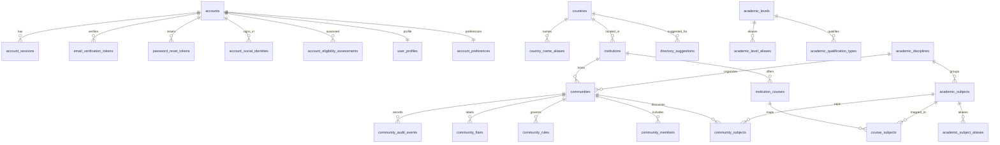

# Database architecture

## Migrations and startup

SQLx applies the ordered migrations in `migrations/` from the root API crate. The current history has two files:

- `202611120001_create_account_authentication.sql`: account credentials, email/reset tokens, sessions, OAuth attempts, pending social signups, and social identities. This tracked migration was recovered unchanged from Git history.
- `202611130001_create_peerfora_core.sql`: geography, academic directory, communities, profiles/preferences, outbox, account lifecycle status, and eligibility evidence. This migration is unpublished in the current working tree.

The second migration is intentionally combined to keep migration count low. Applied migrations must not be edited; use a forward migration for later changes. No Peerfora production database was accessed, so deployment migration history has not been independently checked.

After migrations, `src/database/reference_data.rs` validates and imports `data/reference/countries-iso-codes-4.20.1-1.json`, backfills account preferences, and validates country foreign keys before startup succeeds. The importer checks the pinned source version, 249-row count, code formats, and uniqueness. The refresh script generates the versioned artifact; backend runtime requires Rust, not Python or Node.

## Main relationships and invariants

- `accounts` own sessions, verification/reset tokens, social identities, eligibility assessments, profiles, and preferences.
- Country and territory reference rows link to aliases, institutions, directory suggestions, accounts, and preferences.
- Academic levels, aliases, qualifications, disciplines, subjects, institutions, courses, and course-subject mappings remain data-driven. Seeded values are starter entries, not a complete international catalogue.
- Communities reference optional institution/course/discipline data and link to subjects and members. A composite foreign key ensures an institution-course pairing matches. Deferred constraints require the owner account to have one matching active owner membership. Academic-subject communities require a linked subject.
- Community create/membership operations write audit and outbox rows in the same transaction. There is no outbox processor.
- Account eligibility records store policy version, self-declared method, outcome, and time, without date of birth. Terms acceptance currently stores only a timestamp, not an approved terms/privacy version.

## Security and data lifecycle

Email and username uniqueness are case-insensitive. Account status is one of `active`, `suspended`, `pending_deletion`, or `deleted`; account lookup, social identity lookup, and session lookup require `active`. A deferred constraint prevents an account from committing without a password hash or social identity. Session expiry and one-time token cleanup have indexes. `updated_at` uses database triggers.

These are schema foundations, not full workflows. There is no administrative restriction API, account deletion or anonymization process, export request handling, retention schedule, session activity update, evidence storage, admin RBAC schema, or admin authentication. The OAuth table still stores the PKCE verifier and nonce as plaintext. Directory suggestions have no submission/review API. Country records are not legal availability policy and their source does not provide translated names.

## Relationship map

## Query-oriented indexes

Indexes cover case-insensitive account identifiers; session/token expiry; country, academic and institution aliases; namespace-scoped institution identifiers; institution/course relationships; community discovery, membership, subjects, rules and audit history; account eligibility history; and pending/expired outbox work. The schema migration keeps matching lookup and uniqueness indexes together. Review query plans before adding indexes for new administrative listings or high-volume content tables.
